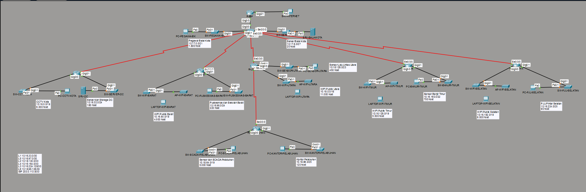
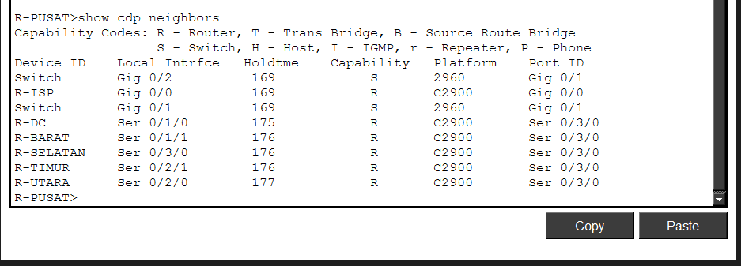
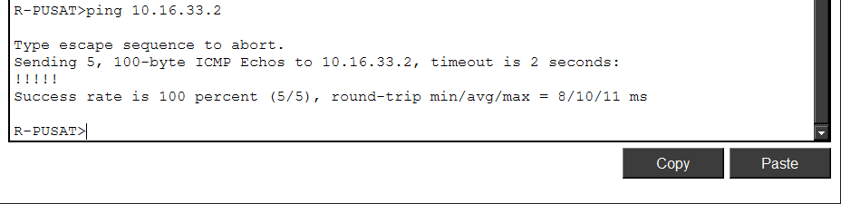
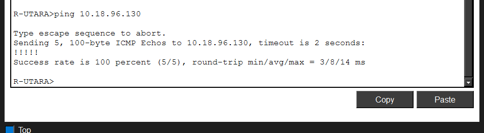
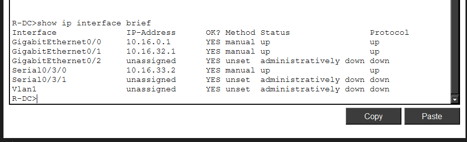
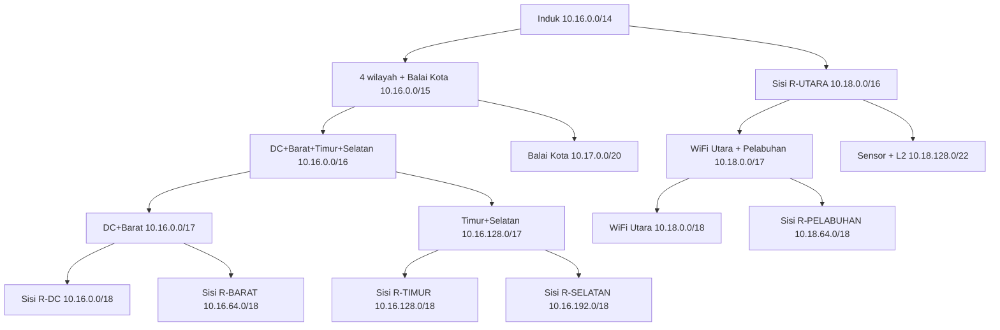

# Mid-Project Jarkom K2 – Implementasi Jaringan Smart City Kota Surabaya

Mid-Project Komunikasi Data dan Jaringan Komputer, Semester Gasal 2026/2027, Departemen Teknologi Informasi ITS.

## Anggota

| Nama                         | NRP        | Bagian                                                                |
| ---------------------------- | ---------- | --------------------------------------------------------------------- |
| Dian Piramidiana Rachmatika  | 5027251031 | Repo, tabel subnetting (soal 2), topologi (soal 1), dokumentasi akhir |
| Muhammad Rifqi Fathurrahman  | 5027251029 | Static routing (soal 3), NAT (soal 5), OSPF (soal 7), uji end-to-end  |
| Ronnin Raditya Putra Partono | 5027251119 | DHCP (soal 4), tunnel GRE + IPsec (soal 6), layanan aplikasi (soal 8) |

## Ringkasan pengalamatan

| Keperluan                                  | Alamat                                      |
| ------------------------------------------ | ------------------------------------------- |
| Base network kelompok (oktet ke-2 = 8 × 2) | 10.16.0.0                                   |
| Skema yang diimplementasikan               | CIDR                                        |
| Link R-PUSAT – R-ISP                       | 203.0.113.8/30                              |
| Server internet                            | 8.8.8.8/24, gateway 8.8.8.1                 |
| Tunnel GRE                                 | 192.168.2.0/30 (R-PUSAT .1, R-PELABUHAN .2) |
| Domain internal                            | k2.smartcity.lab                            |

## Struktur repo

| Folder                    | Isi                                               |
| ------------------------- | ------------------------------------------------- |
| `artefacts/`              | File Packet Tracer (.pkt) dan spreadsheet (.xlsx) |
| `assets/`                 | Screenshot bukti pengujian                        |
| `nodes/`                  | Running-config akhir tiap perangkat               |
| `perquest-scripts/soalN/` | Script konfigurasi per soal per perangkat         |
| `docs/`                   | Catatan serah-terima antar-anggota                |

Format nama screenshot: `JARKOM_MID_[nomor soal]_[isi].png`.

---

## Soal 1 – Perancangan Topologi

> Dikerjakan oleh: Dian Piramidiana Rachmatika (5027251031)
> File: [`artefacts/K2_CIDR.pkt`](artefacts/K2_CIDR.pkt) · Script: [`perquest-scripts/soal1/`](perquest-scripts/soal1/)



### Alasan memilih skema CIDR

Kelompok kami mengimplementasikan skema **CIDR** (blok induk `10.16.0.0/14`), bukan VLSM (`10.16.0.0/16`).

- Dengan CIDR, setiap router punya **satu blok alamat sendiri** yang berisi semua LAN dan link-nya. Contohnya, seluruh jaringan R-DC ada di `10.16.0.0/18`, dan seluruh R-UTARA beserta R-PELABUHAN ada di `10.18.0.0/16`.
- Akibatnya, R-PUSAT cukup memakai **5 rute ringkas + 1 default route**. Dengan VLSM, R-PUSAT butuh **12 rute**, satu per LAN, karena LAN milik router yang sama letaknya terpencar.
- ACL NAT cukup satu baris untuk seluruh jaringan internal (`10.16.0.0 0.3.255.255`).
- Rute yang sedikit juga membuat troubleshooting saat demo lebih cepat.
- Kekurangannya, CIDR lebih boros alamat (pemakaian 16,06% dibanding VLSM 64,23%). Karena memakai rentang privat `10.0.0.0/8`, ketersediaan alamat bukan masalah. Perbandingan lengkapnya ada di soal 2.

### Backbone (sesuai Gambar 1)

Semua router memakai **Cisco ISR 2911**. Model ini punya 3 port Gigabit, slot modul untuk port serial, dan mendukung lisensi `securityk9` yang dibutuhkan untuk IPsec (soal 6).

| Link | Router atas (DCE) | Router bawah (DTE) | Network | Atas | Bawah |
| ---- | ----------------- | ------------------ | ------- | ---- | ----- |
| ISP | R-PUSAT G0/0 | R-ISP G0/0 | 203.0.113.8/30 | .10 | .9 (R-ISP) |
| L1 | R-PUSAT S0/1/0 | R-DC S0/3/0 | 10.16.33.0/30 | .1 | .2 |
| L5 | R-PUSAT S0/1/1 | R-BARAT S0/3/0 | 10.16.97.0/30 | .1 | .2 |
| L2 | R-PUSAT S0/2/0 | R-UTARA S0/3/0 | 10.18.130.0/30 | .1 | .2 |
| L4 | R-PUSAT S0/2/1 | R-TIMUR S0/3/0 | 10.16.164.0/30 | .1 | .2 |
| L3 | R-PUSAT S0/3/0 | R-SELATAN S0/3/0 | 10.16.224.128/30 | .129 | .130 |
| L6 | R-UTARA S0/2/0 | R-PELABUHAN S0/3/0 | 10.18.96.128/30 | .129 | .130 |

**Penambahan port pada router:**

| Router | Modul | Alasan |
| ------ | ----- | ------ |
| R-PUSAT | 3 × HWIC-2T (6 port serial) | 5 link ke router wilayah, 1 port cadangan |
| R-UTARA | 2 × HWIC-2T (4 port serial) | L2, L6, dan 1 port cadangan untuk L7 (soal 7) |
| R-DC | 1 × HWIC-2T | L1 dan 1 port cadangan untuk L7 (soal 7) |
| R-BARAT, R-TIMUR, R-SELATAN, R-PELABUHAN | 1 × HWIC-2T | Link ke router atas |
| R-ISP | – | Cukup port Gigabit bawaan |

**Konvensi yang dipakai:**
- Link antar-router memakai **kabel serial**. Router atas selalu menjadi sisi **DCE** (pemberi `clock rate 64000`).
- Di setiap router bawah, **S0/3/0 selalu menjadi jalur ke router atas**.
- Di setiap /30, router atas memakai host pertama dan router bawah host kedua. Khusus link ISP, R-ISP memakai host pertama (.9).
- Port LAN: **G0/0 = LAN kiri, G0/1 = LAN kanan**, sesuai urutan di Gambar 1.

### Desain setiap lokasi

Setiap LAN memakai **1 switch Cisco 2960** dan **1 perangkat perwakilan**, sesuai ketentuan soal. Perhitungan subnet tetap memakai jumlah host penuh. Switch dipasang di setiap LAN supaya jaringan bisa diperluas, misalnya menambah PC, kamera, atau Access Point, tanpa mengubah router.

| Jenis LAN | Perangkat perwakilan | Media | Alasan |
| --------- | -------------------- | ----- | ------ |
| WiFi Publik (Barat, Utara, Timur, Selatan) | Switch → **Access Point** → **Laptop** wireless | Kabel ke AP, wireless ke laptop | Pengguna WiFi publik adalah perangkat mobile. SSID dibedakan per wilayah (`WiFi-Publik-Barat`, dst.) supaya laptop tidak tersambung ke AP wilayah lain. Dibuat terbuka sesuai sifat layanan publik |
| CCTV Kota | PC | Kabel | Mewakili kamera/perekam yang harus bisa mengunggah rekaman ke FTP (soal 8) |
| Sensor Lalu Lintas, Sensor Banjir, PJU Pintar, Sensor dan SCADA | PC | Kabel | Perangkat IoT kota butuh koneksi stabil. PC dipakai karena mendukung DHCP dan pengujian ping |
| Pegawai Balai Kota, Kantor Pelabuhan, Puskesmas dan Sekolah | PC | Kabel | Pengguna kantor, klien web dan email (soal 8) |
| Server Balai Kota, Server dan Storage DC | Server | Kabel | Tempat layanan web, DNS, FTP, dan DHCP (soal 4 dan 8) |

**Jenis kabel:** router–router memakai Serial DCE, kecuali R-PUSAT–R-ISP yang memakai Copper Cross-Over (perangkat sejenis). Router–switch, switch–PC/server, dan switch–AP memakai Copper Straight-Through (perangkat berbeda jenis).

**Pengalamatan perangkat akhir:**
- Server memakai IP statis: SRV-INTERNET `8.8.8.8`, SRV-BALAIKOTA `10.17.8.2`, SRV-DC `10.16.32.2`.
- PC dan laptop memakai DHCP (dikonfigurasi di soal 4).

**Penamaan:** semua perangkat diberi nama sesuai tempatnya, misalnya `R-PUSAT`, `SW-CCTV-KOTA`, `PC-CCTV-KOTA`, `AP-WIFI-BARAT`, `LAPTOP-WIFI-BARAT`, dan `SRV-DC`. Setiap LAN diberi label berisi nama subnet, network/prefix, dan jumlah host.

### Konfigurasi IP router

Script lengkap ada di [`perquest-scripts/soal1/`](perquest-scripts/soal1/). Contoh R-PUSAT:

```
enable
configure terminal
hostname R-PUSAT
no ip domain-lookup
interface g0/0
 description Link ke R-ISP
 ip address 203.0.113.10 255.255.255.252
 no shutdown
interface g0/1
 description LAN Pegawai Balai Kota
 ip address 10.17.0.1 255.255.248.0
 no shutdown
interface g0/2
 description LAN Server Balai Kota
 ip address 10.17.8.1 255.255.255.224
 no shutdown
interface s0/1/0
 description L1 ke R-DC
 ip address 10.16.33.1 255.255.255.252
 clock rate 64000
 no shutdown
interface s0/1/1
 description L5 ke R-BARAT
 ip address 10.16.97.1 255.255.255.252
 clock rate 64000
 no shutdown
interface s0/2/0
 description L2 ke R-UTARA
 ip address 10.18.130.1 255.255.255.252
 clock rate 64000
 no shutdown
interface s0/2/1
 description L4 ke R-TIMUR
 ip address 10.16.164.1 255.255.255.252
 clock rate 64000
 no shutdown
interface s0/3/0
 description L3 ke R-SELATAN
 ip address 10.16.224.129 255.255.255.252
 clock rate 64000
 no shutdown
end
copy running-config startup-config
```

- `hostname` memberi nama router sesuai lokasinya.
- `no ip domain-lookup` mencegah router menunggu lama saat ada perintah yang salah ketik.
- `description` menandai fungsi tiap interface, sehingga `show interfaces description` langsung menunjukkan link mana yang mana.
- `clock rate 64000` hanya dipasang di sisi DCE (router atas).
- `copy running-config startup-config` menyimpan konfigurasi supaya tidak hilang saat router di-restart.

Router lain memakai pola yang sama dengan nilai berikut:

| Router | G0/0 (LAN kiri) | G0/1 (LAN kanan) | S0/3/0 (ke atas) | Tambahan |
| ------ | --------------- | ---------------- | ---------------- | -------- |
| R-DC | 10.16.0.1/19 | 10.16.32.1/24 | 10.16.33.2/30 | – |
| R-BARAT | 10.16.64.1/19 | 10.16.96.1/24 | 10.16.97.2/30 | – |
| R-UTARA | 10.18.0.1/18 | 10.18.128.1/23 | 10.18.130.2/30 | S0/2/0 10.18.96.129/30 (L6, DCE) |
| R-TIMUR | 10.16.128.1/19 | 10.16.160.1/22 | 10.16.164.2/30 | – |
| R-SELATAN | 10.16.192.1/19 | 10.16.224.1/25 | 10.16.224.130/30 | – |
| R-PELABUHAN | 10.18.64.1/19 | 10.18.96.1/25 | 10.18.96.130/30 | – |
| R-ISP | 203.0.113.9/30 (ke R-PUSAT) | 8.8.8.1/24 (server) | – | Tidak ada rute ke alamat privat |

### Pengujian

**1. Kabel backbone tersambung ke port yang benar.** `show cdp neighbors` di R-PUSAT menunjukkan setiap port serial terhubung ke router yang direncanakan, dan semuanya ke port Ser 0/3/0 di sisi router bawah. R-ISP terhubung di Gig 0/0, sedangkan switch LAN Pegawai dan LAN Server Balai Kota terhubung di Gig 0/1 dan Gig 0/2.



**2. Semua link backbone aktif.** Ping dari R-PUSAT ke router bawah di setiap link (`10.16.33.2`, `10.16.97.2`, `10.18.130.2`, `10.16.164.2`, `10.16.224.130`) dan ke R-ISP (`203.0.113.9`) berhasil. Ping L6 dari R-UTARA ke `10.18.96.130` juga berhasil. Ping pertama kadang `.!!!!` karena router masih melakukan ARP.





**3. Semua LAN aktif.** Pada setiap router, `show ip interface brief` menunjukkan G0/0 dan G0/1 berstatus `up up` dengan IP sesuai tabel. Ping dari router ke server (`10.17.8.2`, `10.16.32.2`, dan `8.8.8.8` dari R-ISP) berhasil.



**4. Laptop WiFi terhubung ke AP wilayahnya.** Di topologi terlihat garis wireless dari setiap AP ke laptop di wilayah yang sama.

> Pada tahap ini router belum memiliki rute ke jaringan lain, sehingga ping antar-LAN yang berbeda router belum bisa berhasil. Routing dikerjakan di soal 3.

## Soal 2 – Tabel Subnetting

> Dikerjakan oleh: Dian Piramidiana Rachmatika (5027251031), berdasarkan lembar jawaban UTS kelompok
> File: [`artefacts/K2_Subnetting_SmartCity.xlsx`](artefacts/K2_Subnetting_SmartCity.xlsx)

Spreadsheet berisi sheet **Info, Kebutuhan, VLSM, CIDR, Supernet, Efisiensi, dan Revisi**. Kolom network, range, broadcast, dan gateway dihitung dengan rumus. Kolom *Cek aligned* dan *Cek urut* memastikan setiap network habis dibagi ukuran bloknya dan tidak ada subnet yang tumpang tindih.

### Base network dan kebutuhan

Base network: oktet ke-2 = 8 × nomor kelompok = 8 × 2 = **16**, sehingga dipakai `10.16.0.0`. Rentang privat `10.0.0.0/8` dipilih karena paling besar (16,7 juta alamat). Kebutuhan CIDR mencapai 262.144 alamat, sehingga `192.168.0.0/16` (65.536 alamat) tidak cukup.

Kebutuhan alamat LAN = host + 1 gateway + 2 (network dan broadcast). Link antar-router memakai /30.

| Router | LAN | Host | Kebutuhan | Blok | Prefix |
| ------ | --- | ---: | --------: | ---: | :----: |
| R-PUSAT | Pegawai Balai Kota | 1.800 | 1.803 | 2.048 | /21 |
| R-PUSAT | Server Balai Kota | 20 | 23 | 32 | /27 |
| R-DC | CCTV Kota | 6.000 | 6.003 | 8.192 | /19 |
| R-DC | Server dan Storage DC | 180 | 183 | 256 | /24 |
| R-UTARA | WiFi Publik Utara | 11.000 | 11.003 | 16.384 | /18 |
| R-UTARA | Sensor Lalu Lintas Utara | 450 | 453 | 512 | /23 |
| R-PELABUHAN | Sensor dan SCADA Pelabuhan | 5.000 | 5.003 | 8.192 | /19 |
| R-PELABUHAN | Kantor Pelabuhan | 120 | 123 | 128 | /25 |
| R-SELATAN | WiFi Publik Selatan | 6.500 | 6.503 | 8.192 | /19 |
| R-SELATAN | PJU Pintar Selatan | 90 | 93 | 128 | /25 |
| R-TIMUR | WiFi Publik Timur | 5.500 | 5.503 | 8.192 | /19 |
| R-TIMUR | Sensor Banjir Timur | 700 | 703 | 1.024 | /22 |
| R-BARAT | WiFi Publik Barat | 4.500 | 4.503 | 8.192 | /19 |
| R-BARAT | Puskesmas dan Sekolah Barat | 220 | 223 | 256 | /24 |
| – | L1–L6 (6 link) | 2 | 4 | 4 | /30 |

### Tabel VLSM

Subnet diurutkan dari blok terbesar dan dialokasikan berurutan mulai `10.16.0.0`.

| Subnet | Network ID | Prefix | Rentang host | Broadcast | Gateway |
| ------ | ---------- | :----: | ------------ | --------- | ------- |
| WiFi Publik Utara | 10.16.0.0 | /18 | 10.16.0.1 – 10.16.63.254 | 10.16.63.255 | 10.16.0.1 |
| WiFi Publik Selatan | 10.16.64.0 | /19 | 10.16.64.1 – 10.16.95.254 | 10.16.95.255 | 10.16.64.1 |
| CCTV Kota | 10.16.96.0 | /19 | 10.16.96.1 – 10.16.127.254 | 10.16.127.255 | 10.16.96.1 |
| WiFi Publik Timur | 10.16.128.0 | /19 | 10.16.128.1 – 10.16.159.254 | 10.16.159.255 | 10.16.128.1 |
| Sensor dan SCADA Pelabuhan | 10.16.160.0 | /19 | 10.16.160.1 – 10.16.191.254 | 10.16.191.255 | 10.16.160.1 |
| WiFi Publik Barat | 10.16.192.0 | /19 | 10.16.192.1 – 10.16.223.254 | 10.16.223.255 | 10.16.192.1 |
| Pegawai Balai Kota | 10.16.224.0 | /21 | 10.16.224.1 – 10.16.231.254 | 10.16.231.255 | 10.16.224.1 |
| Sensor Banjir Timur | 10.16.232.0 | /22 | 10.16.232.1 – 10.16.235.254 | 10.16.235.255 | 10.16.232.1 |
| Sensor Lalu Lintas Utara | 10.16.236.0 | /23 | 10.16.236.1 – 10.16.237.254 | 10.16.237.255 | 10.16.236.1 |
| Puskesmas dan Sekolah Barat | 10.16.238.0 | /24 | 10.16.238.1 – 10.16.238.254 | 10.16.238.255 | 10.16.238.1 |
| Server dan Storage DC | 10.16.239.0 | /24 | 10.16.239.1 – 10.16.239.254 | 10.16.239.255 | 10.16.239.1 |
| Kantor Pelabuhan | 10.16.240.0 | /25 | 10.16.240.1 – 10.16.240.126 | 10.16.240.127 | 10.16.240.1 |
| PJU Pintar Selatan | 10.16.240.128 | /25 | 10.16.240.129 – 10.16.240.254 | 10.16.240.255 | 10.16.240.129 |
| Server Balai Kota | 10.16.241.0 | /27 | 10.16.241.1 – 10.16.241.30 | 10.16.241.31 | 10.16.241.1 |
| L1 PUSAT–DC | 10.16.241.32 | /30 | 10.16.241.33 – 10.16.241.34 | 10.16.241.35 | – |
| L5 PUSAT–BARAT | 10.16.241.36 | /30 | 10.16.241.37 – 10.16.241.38 | 10.16.241.39 | – |
| L2 PUSAT–UTARA | 10.16.241.40 | /30 | 10.16.241.41 – 10.16.241.42 | 10.16.241.43 | – |
| L4 PUSAT–TIMUR | 10.16.241.44 | /30 | 10.16.241.45 – 10.16.241.46 | 10.16.241.47 | – |
| L3 PUSAT–SELATAN | 10.16.241.48 | /30 | 10.16.241.49 – 10.16.241.50 | 10.16.241.51 | – |
| L6 UTARA–PELABUHAN | 10.16.241.52 | /30 | 10.16.241.53 – 10.16.241.54 | 10.16.241.55 | – |

Total blok 61.752 alamat, sehingga blok induk VLSM adalah `10.16.0.0/16`.

### Pohon penggabungan CIDR (supernet per router)

Setiap "sisi" router berisi LAN-nya dan link ke router atas. Aturan penggabungan: prefix sama naik 1; prefix berbeda ambil blok terbesar lalu naik 1. Alokasi dilakukan dari atas ke bawah: anak terbesar di awal blok induk, anak kedua di awal paruh kedua.



| Supernet | Network | Isi |
| -------- | ------- | --- |
| Sisi R-DC | 10.16.0.0/18 | CCTV /19, Server DC /24, L1 /30 |
| Sisi R-BARAT | 10.16.64.0/18 | WiFi Barat /19, Puskesmas /24, L5 /30 |
| Sisi R-TIMUR | 10.16.128.0/18 | WiFi Timur /19, Sensor Banjir /22, L4 /30 |
| Sisi R-SELATAN | 10.16.192.0/18 | WiFi Selatan /19, PJU /25, L3 /30 |
| Balai Kota (R-PUSAT) | 10.17.0.0/20 | Pegawai /21, Server Balai Kota /27 |
| Sisi R-PELABUHAN | 10.18.64.0/18 | SCADA /19, Kantor /25, L6 /30 |
| Sisi R-UTARA | 10.18.0.0/16 | WiFi Utara /18, sisi R-PELABUHAN /18, Sensor Lalu Lintas /23, L2 /30 |
| Induk | 10.16.0.0/14 | Seluruh jaringan internal |

### Tabel CIDR (diimplementasikan)

| Subnet | Network ID | Prefix | Rentang host | Broadcast | Gateway |
| ------ | ---------- | :----: | ------------ | --------- | ------- |
| CCTV Kota | 10.16.0.0 | /19 | 10.16.0.1 – 10.16.31.254 | 10.16.31.255 | 10.16.0.1 |
| Server dan Storage DC | 10.16.32.0 | /24 | 10.16.32.1 – 10.16.32.254 | 10.16.32.255 | 10.16.32.1 |
| L1 PUSAT–DC | 10.16.33.0 | /30 | 10.16.33.1 – 10.16.33.2 | 10.16.33.3 | – |
| WiFi Publik Barat | 10.16.64.0 | /19 | 10.16.64.1 – 10.16.95.254 | 10.16.95.255 | 10.16.64.1 |
| Puskesmas dan Sekolah Barat | 10.16.96.0 | /24 | 10.16.96.1 – 10.16.96.254 | 10.16.96.255 | 10.16.96.1 |
| L5 PUSAT–BARAT | 10.16.97.0 | /30 | 10.16.97.1 – 10.16.97.2 | 10.16.97.3 | – |
| WiFi Publik Timur | 10.16.128.0 | /19 | 10.16.128.1 – 10.16.159.254 | 10.16.159.255 | 10.16.128.1 |
| Sensor Banjir Timur | 10.16.160.0 | /22 | 10.16.160.1 – 10.16.163.254 | 10.16.163.255 | 10.16.160.1 |
| L4 PUSAT–TIMUR | 10.16.164.0 | /30 | 10.16.164.1 – 10.16.164.2 | 10.16.164.3 | – |
| WiFi Publik Selatan | 10.16.192.0 | /19 | 10.16.192.1 – 10.16.223.254 | 10.16.223.255 | 10.16.192.1 |
| PJU Pintar Selatan | 10.16.224.0 | /25 | 10.16.224.1 – 10.16.224.126 | 10.16.224.127 | 10.16.224.1 |
| L3 PUSAT–SELATAN | 10.16.224.128 | /30 | 10.16.224.129 – 10.16.224.130 | 10.16.224.131 | – |
| Pegawai Balai Kota | 10.17.0.0 | /21 | 10.17.0.1 – 10.17.7.254 | 10.17.7.255 | 10.17.0.1 |
| Server Balai Kota | 10.17.8.0 | /27 | 10.17.8.1 – 10.17.8.30 | 10.17.8.31 | 10.17.8.1 |
| WiFi Publik Utara | 10.18.0.0 | /18 | 10.18.0.1 – 10.18.63.254 | 10.18.63.255 | 10.18.0.1 |
| Sensor dan SCADA Pelabuhan | 10.18.64.0 | /19 | 10.18.64.1 – 10.18.95.254 | 10.18.95.255 | 10.18.64.1 |
| Kantor Pelabuhan | 10.18.96.0 | /25 | 10.18.96.1 – 10.18.96.126 | 10.18.96.127 | 10.18.96.1 |
| L6 UTARA–PELABUHAN | 10.18.96.128 | /30 | 10.18.96.129 – 10.18.96.130 | 10.18.96.131 | – |
| Sensor Lalu Lintas Utara | 10.18.128.0 | /23 | 10.18.128.1 – 10.18.129.254 | 10.18.129.255 | 10.18.128.1 |
| L2 PUSAT–UTARA | 10.18.130.0 | /30 | 10.18.130.1 – 10.18.130.2 | 10.18.130.3 | – |

### Perbandingan efisiensi

| Metode | Blok induk | Host terpakai | Pemakaian | Alamat terbuang |
| ------ | ---------- | ------------: | --------: | --------------: |
| VLSM | /16 (65.536) | 42.092 | 64,23% | 23.444 |
| CIDR | /14 (262.144) | 42.092 | 16,06% | 220.052 |

VLSM lebih efisien 48,17 poin persen, karena subnet ditempatkan berurutan tanpa celah. CIDR membulatkan setiap sisi router ke blok 2ⁿ, misalnya sisi Utara yang hanya berisi sekitar 25 ribu alamat menjadi /16. Kelompok kami tetap memilih CIDR karena rute dan ACL menjadi jauh lebih ringkas (lihat soal 1).

### Tabel revisi terhadap lembar jawaban UTS

Rincian lengkap (20 baris) ada di sheet **Revisi**. Ringkasannya:

| Bagian | Jawaban UTS | Perbaikan | Alasan |
| ------ | ----------- | --------- | ------ |
| VLSM Pegawai Balai Kota | broadcast 10.16.230.255 | 10.16.231.255 | /21 memakan 8 nilai oktet ke-3 (224–231), bukan 7 |
| VLSM Sensor Banjir s.d. Server Balai Kota | network bergeser | sesuai tabel VLSM di atas | Pergeseran akibat baris Pegawai, dan /24 terhitung memakan 2 nilai oktet ke-3 |
| VLSM link L1–L5 | network .33, .37, … | .32, .36, … | Network /30 harus kelipatan 4 |
| VLSM link L6 | tidak ada | 10.16.241.52/30 | Link R-UTARA – R-PELABUHAN terlewat |
| Sketsa topologi, Puskesmas Barat | /25 | /24 | 220 + 3 = 223 > 128 |
| Pohon CIDR | induk /15, ukuran sisi router tidak sesuai | induk /14, sisi sesuai tabel supernet | Total sisi 135.168 alamat > 131.072 (/15) |
| Tabel CIDR | belum diisi | dilengkapi | Disusun dari pohon penggabungan yang diperbaiki |
| Efisiensi (soal 5) | prefix VLSM /17, CIDR lebih efisien | prefix VLSM /16, VLSM lebih efisien | 61.752 > 32.768 (/17); 64,23% > 16,06% |

## Soal 3 – Static Routing

_Belum dikerjakan._

## Soal 4 – DHCP

_Belum dikerjakan._

## Soal 5 – NAT

_Belum dikerjakan._

## Soal 6 – Tunnel GRE

_Belum dikerjakan._

## Soal 7 – Dynamic Routing OSPF

_Belum dikerjakan._

## Soal 8 – Layanan Aplikasi Smart City

_Belum dikerjakan._
